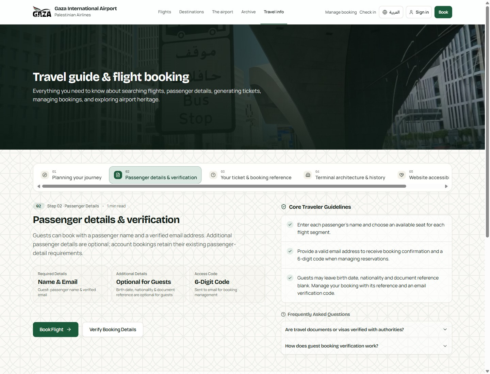
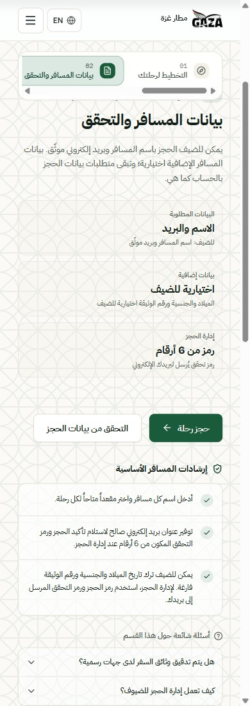

# PR #18 review corrections ? 2026-10-17

Review baseline: `384c66da1d0fdc6ff135e0f96f0707dcc0e16b15`.
Independent review: https://github.com/Bassamalsaqqa/gaza-gateway/pull/18#pullrequestreview-5552971284

## Guest checkout decision

Guests enter one passenger name and verify a contact email. Additional date of
birth, nationality and document reference are optional in a collapsed disclosure.
The name remains intact, including Arabic and single names. No passport number,
birth date, nationality or family name is invented. Omitted details persist as
SQL NULL; the contact phone retains the established empty-string representation.
Existing account input requirements are unchanged.

Guest endpoints select an explicit guest parser/schema. Closed shapes, limits,
malformed supplied details, age validation when birth date is supplied, verified
email/session ownership, CSRF/Origin/TLS checks, real seat choice and atomic trip
validation remain enforced. Ambiguous name/firstName aliases are rejected.
The existing in-memory submission/UUID freeze and replay protections are retained.

The forward migration relaxes only last_name/dob/nationality/document and preserves
immutable historical rows. Its single atomic ALTER changes the name constraint
and nullability together. Down refuses while any nullable guest details exist;
no backfilling or destructive rollback is included. Future release preparation
must account for this forward-repair boundary in addition to Issue #15.

## Availability semantics

The route/date availability endpoint adds explicit scheduledDates, bookableDates,
partySize (1?9), seatsRemaining, totalCapacity and bookable. availableDates is the
bookable-date alias. Schedule existence is no longer sufficient for a suggestion.
Two batch queries read materialized services and physical seat claims, without
per-flight N+1 queries. Static blocked seats and claims reduce capacity. Frozen
service configuration must match the same current authority checked at booking;
incompatible or invalid authority is not recommended as bookable. Cancelled
bookings release claims and restore availability. Capacity is advisory: final
booking still locks and validates seats. This does not reserve seats at search.

The live availability wire contract requires complete capacity fields and exact
scheduled/bookable date sets. Ranking fails closed when capacity is missing or
invalid. The search has no party selector, so its default snapshot is for one
passenger; the endpoint supports explicit partySize and booking still checks the
actual selected party. Existing generic dated-offering endpoints retain their
established shape.

## Focused verification

- Integrated guest/trip/search/travel frontend: 52 tests PASS.
- Integrated PHP 8.4 ReservationCommandTest: 34 tests / 89 assertions PASS;
  one PHPUnit deprecation notice.
- Integrated disposable PHP 8.4 / MySQL 8.4 minimal one-way and round-trip
  creation/replay: 2 tests / 55 assertions PASS, receipt mysql_mvp_7bb7bad9af1a;
  23 migrations applied, owned resources removed.
- Integrated availability endpoint: 13 tests / 101 assertions PASS, receipt
  mysql_mvp_1859b873654c; fully booked/partial/static-blocked/frozen-service,
  cancellation-release, party-size and bounded-query cases covered.
- TypeScript PASS; changed TS/TSX ESLint PASS with zero errors/warnings.
- Approved ticket TSX, CSS and seven assets compared with pinned SHA-256 values:
  all nine files unchanged. No further PDF or artwork verification performed.

## Fresh EN/AR captures

The two final guide captures use the actual current React guide and published
content in a separate loopback frontend-only development preview. They show the
new guest-data guidance and final neutral copy, not backend booking acceptance.

## HTTPS and acceptance boundary

The disposable HTTPS PHP/MySQL preview uses a generated localhost/127.0.0.1 SAN
certificate, Secure cookies and unmodified product CSRF/Origin checks. A local
SMTP sink receives OTPs through the real bounded dispatcher; no production mail,
credentials, database, routing or trust store is touched. The owner later asked
to avoid email presentation inspection and prioritize code-level delivery logic.

The browser currently stops at ERR_CERT_AUTHORITY_INVALID. The owner has been
asked to handle that local warning. No agent warning bypass or insecure browser
flag was used. Complete guest booking/OTP/confirmation/ticket/management/cancel
browser acceptance remains pending until that handoff; source gates are not a
substitute for the real browser journey. No complete browser flow is claimed.

Main/production unchanged. Production remains owner-recorded application 96538d9.
Issue #15 remains an independent release gate. No merge, production build,
production ZIP, deployment, staging or GitHub Actions.
