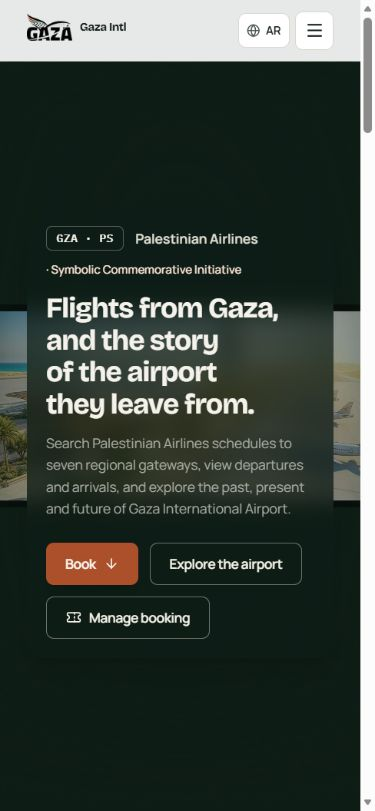
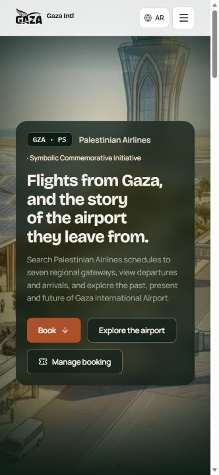
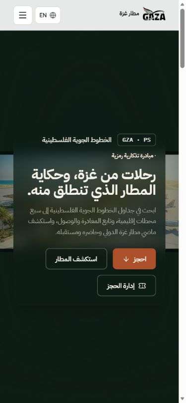
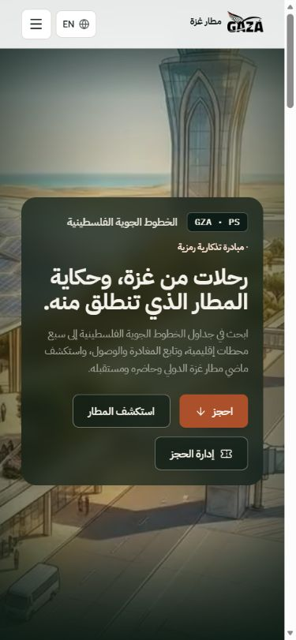

# Issue #16 independent review evidence

Implementation: **`e50776220c9ef0b8473ecc78160de921207e3ef8`**.
The subsequent review-evidence commit changes documentation only. Application,
media, tests and scripts remain identical to that implementation commit.
Latest main fetched for this PR: `47c64df8d65935cc77487bda753dbbca6a2470b3`.

[Implementation handoff](../../production/MOBILE_CINEMATIC_ISSUE_16_2026-10-16.md)
contains crop rationale, viewport observations, asset reproduction commands and
limitations. Its no-push statement records the earlier implementation handback;
publication is authorized separately by the owner for this review PR.

## Actual before / after screenshots

Before: read-only production at the owner-confirmed installed application
`96538d9affdc843d08ef3c801f15c7f92dfd46b3`, original contain rendering.
After: exact local implementation component, with production EN/AR homepage
markup and CSS used read-only as foreground context. Application actions are not
exercised by this isolated fixture. All comparisons are at scroll/frame 0.

These are unretouched JPEG captures from actual Edge desktop responsive
viewports, not physical-device screenshots. CSS viewport is 390×844 portrait or
844×390 landscape. Screenshot raster sizes can differ due to browser capture
scaling and scrollbar. Captures with a transient browser scaling artifact were
discarded and recaptured before publication.

| Locale / orientation | Before | After |
| --- | --- | --- |
| EN portrait |  |  |
| AR portrait |  |  |
| EN landscape |  |  |
| AR landscape |  |  |

Portrait is a deliberate crop: it retains the canopy, frontage and tower while
excluding much of the distant apron. Foreground cards/header can overlap the
film, as in the existing UI. Wider portrait tablets intentionally use the wide
crop to avoid vertically clipping the tower with the tall phone crop.

## Exact media bytes

These SHA-256 values were recomputed from public asset bytes and checked against
the source manifest. [Machine-readable verification](media-hashes.json).

| Asset | Bytes | SHA-256 |
| --- | ---: | --- |
| Portrait MP4 | 1,502,795 | `7f4323c07ea7ed1024fd52e71045c464eb9d3e9e3c9eae79f527019269b52747` |
| Portrait WebP | 43,448 | `4d93a2389481d1a3fbb66258c57ce32619873c411bef447808eccec7a17560c1` |
| Landscape MP4 | 2,925,325 | `ccf5d232dc7cff439d08dedba6ca59bf66f0fd24015ffa8ae0d1418e0f0b85ea` |
| Landscape WebP | 79,120 | `a7f9e809b91823b680cb1ba3b2ae68e61d3077b27b09ee0eeef957cd71670a13` |

## Focused evidence

- [8 focused unit tests passed](focused-unit-tests.txt); this transcript was
  captured afresh for publication, without broad test groups or a build.
- [TypeScript `--noEmit` passed](typecheck.txt), also captured for publication.
- [7 native first-presented-frame checks](first-frame-receipt.json) and
  [4 legacy decode-signal checks](first-frame-legacy-receipt.json) from the
  implementation session, exercising the actual component/native MP4 decoder.
  The deliberate held-seek timeout in the native receipt is an expected test
  stimulus; `passed: true` includes its fallback/cleanup assertions.
- [Rotation to landscape](rotation-landscape.json),
  [rotation back to portrait in AR](ar-rotation-portrait.json),
  [height-only browser-chrome resize](browser-chrome-resize.json),
  [current AR landscape hero](ar-landscape-hero-final.json) and
  [unchanged desktop source selection](1280x720-en.json).
- Static cover posters with zero MP4 requests under harness-injected
  [Save-Data](fallback-save-data.json), [low memory](fallback-low-memory.json) and
  [AR reduced motion](fallback-reduced-motion-ar.json).
  [Real missing-media error and decoder cleanup](fallback-native-media-error.json).
- [Evidence byte hashes and original capture/write timestamps](evidence-manifest.json).
  The packet combines retained implementation evidence and the fresh AR comparison
  captures. It does not represent a second full browser matrix or production test.

The retained first-frame fixture controls near/hidden lifecycle transitions;
physical mobile tab-background/return, Safari/Android decoding, real browser
chrome and cutout safe areas remain owner device checks. The SSR-only check in
the handoff omitted the application hydration module; it did not globally disable
browser JavaScript. No physical-device certification is claimed.

## Release boundary

This PR is for independent source review only. No merge, production build, ZIP,
Actions, deployment, database change or upgrade execution is authorized here.
Production remains at **application `96538d9`**. **Issue #15's database-preservation
certification remains outstanding**, independently of this mobile UI PR.

Do not use the old **b3-based installer/kit** for the next release. A future
owner-authorized release must verify the actual current `96538d9` installation,
resolve the separate certification/tooling requirements, use reviewed compatible
upgrade tooling and include the reviewed public-directory permission correction.
Do not clear old attempt markers, rerun the failed upgrade or reset databases.
The final clean production build and integration decision follow independent
review and separate owner authorization.
